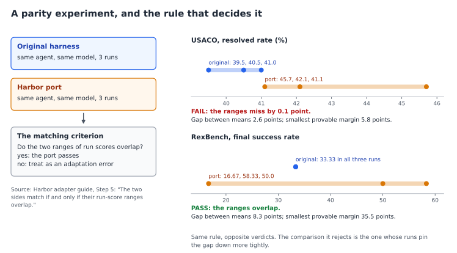
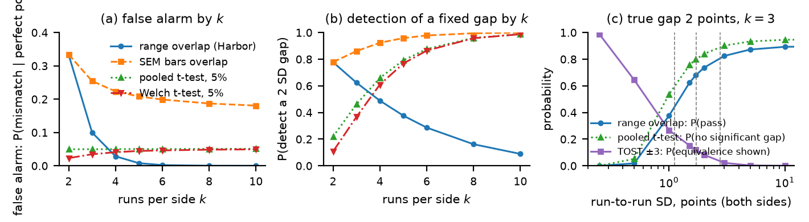
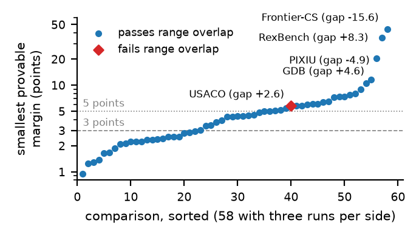
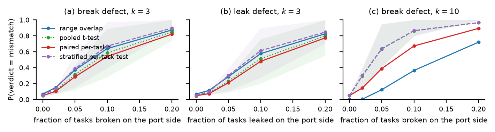
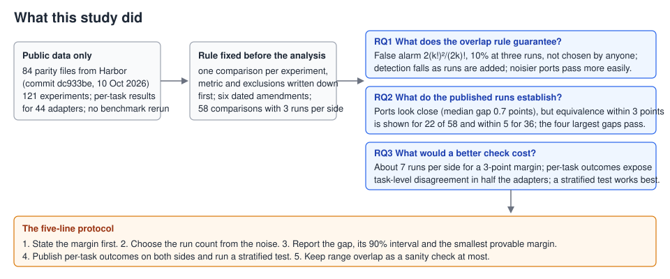

# How much does a parity experiment prove?

A statistical look at the rule that accepts benchmark ports in Harbor, the evaluation framework behind Terminal-Bench.

Poorva Barve, 2026. Short paper under preparation for the AGENT workshop at ICSE 2027.

[Read the paper](paper/main.pdf) · [Results summary](memos/results-memo.md)

## The question

Harbor hosts more than eighty existing benchmarks, each ported through an "adapter". A port should preserve the original benchmark scores within a meaningful tolerance. Harbor requires a **parity experiment** for each adapter: the same agent and model are run on the original harness and on the port, usually three times each. Harbor's adapter guide (`ADAPTER_CONTRIBUTING.md`, Step 5 of its detailed specification) decides the outcome with one rule: the two sides match if and only if the ranges of their run scores overlap.



The two records above are real. USACO fails the rule by a tenth of a point with a gap of 2.6 points between the means. RexBench passes with a gap of 8.3 points, because its port scores spread from 17 to 58 across three runs. I ask three questions.

1. What does the overlap rule guarantee?
2. What do the published parity runs establish?
3. What would a better check cost?

Everything here uses public data: the parity files in the Harbor repository, the per-task result files the maintainers published on Hugging Face, and their paper. No benchmark was rerun and no agent or model was evaluated.

## Findings

**The rule is a weak test, and in a way that cannot be fixed by running it harder.** With three runs per side it flags a perfect port 10% of the time when scores cannot tie (4 to 9% for pass counts that can), and nobody chooses that rate: it is set by the run count. Adding runs makes it *less* likely to catch a real gap, because wider ranges overlap more easily. For a true gap of 2 points under common normal noise, the overlap pass probability rises from 2% at an SD of 0.5 points to 68% at the median observed SD. The pooled t-test also misses the gap more often as noise grows, and TOST establishes equivalence less often. A pass means "not rejected at the 10% level"; it never means the port is within any stated distance of the original.



*Left: the false-alarm rate is fixed by the run count. Middle: detection of a fixed gap falls with more runs for the overlap rule and rises for a t-test. Right: for a fixed 2-point gap, more noise means more passes; dashed lines mark the quartiles of the run-to-run SD in the published runs (1.1, 1.7 and 2.7 points). "SEM bars overlap" is one reading of the Harbor paper's wording.*

**The published runs look close but prove little.** Of the 58 comparisons with three runs per side, the median absolute gap between original and port is 0.7 points, and no gap is distinguishable from zero. But three runs cannot show much: equivalence within 3 points can be shown for only 22 of the 58, and within 5 points for 36. The rule passes the four largest gaps (15.6, 8.3, 4.9 and 4.6 points). The one comparison it fails, USACO, has better evidence of closeness than 18 of the passes.



*Each marker shows the smallest equivalence margin supported by one comparison with three runs per side. The diamond marks USACO, the only comparison whose ranges do not overlap. Lines mark 3 and 5 points. Labels identify the four comparisons with the largest absolute gaps.*

**An equivalence test needs more runs.** With normal noise, a common SD at the observed median, and a true gap of zero, an equivalence test needs about seven runs per side for a 3-point margin and 80% power, compared with the usual three. Per-task outcomes, which the published files hold for both sides in 44 adapters, do not make the interval tighter, but they reveal something the run scores hide: the two sides disagree on individual tasks more than shared pass probabilities allow in 14 of 27 adapters at an unadjusted 5% threshold and in 11 after Benjamini–Hochberg correction at a 5% false discovery rate. A within-task permutation test found no statistically detectable mean gap in any of the 27. In the per-task simulations, with ten runs per side, range overlap catches a defect that breaks 10% of tasks in 36% of trials. The pooled t-test and the stratified-by-task test each catch it in 86%.



*How often each test notices a defect that breaks or leaks a share of tasks on the port side, averaged over 30 adapters.*

One open question came out of the per-task files: on nine of thirty Harbor sides, the published run totals vary less from run to run than their own per-task flips allow. This diagnostic is consistent with dependence within or between runs, but does not identify the cause.

## How the study was done



The analysis rules (which metric counts, which rows are excluded, how units are handled) were written down in `memos/phase-2-preregistration.md` before the results were computed, and every later change is logged there with its date and reason. This is an analysis plan committed to the repository, not a registration with an outside registry. Every number in the memos and the paper maps to a script and an output file: `NUMBERS.md`, `results/phase2/NUMBERS_phase2.md` and `paper/NUMBERS_paper.md`.

## Recommended protocol

1. State the margin before running: how many points of difference would make the port a different benchmark.
2. Choose the run count from the noise, for 80% power at that margin; start with at least five runs per side when the noise is unknown.
3. Report the gap with its 90% interval and the smallest provable margin. Declare equivalence only when the interval lies inside the margin; otherwise say "not yet shown".
4. Publish per-task outcomes on both sides with aligned task ids and report a stratified-by-task test.
5. Keep range overlap as a sanity check at most.

## Try it on a parity file

```bash
.venv/bin/python -I scripts/parity_verdict.py data/raw/harbor_parity/usaco.json
```

```
== usaco | agent claude-code@v2.0.34 | model claude-haiku-4-5-20251001 | parity set 304/304
   Resolved Rate (%): k=3v3 | ranges DO NOT overlap (separation +0.1) | gap +2.63 pts [90%: -0.49, +5.76] [95%: -1.43, +6.70] | run SD 1.79 | smallest provable margin ±5.8 pts | runs/side for 80% power at this noise: ±3 -> 7, ±5 -> 4
```

The script works on any `parity_experiment.json` from the Harbor repository.

## Reproduce

```bash
uv venv --python 3.12 .venv && uv pip install --python .venv/bin/python -r requirements.txt
bash scripts/run_phase0.sh
bash scripts/run_phase2.sh
bash paper/build.sh
```

The first two scripts regenerate the phase 0 and phase 2 outputs and the paper's figures and tables, and run the tests. Not regenerated: the phase 1 search records, and `results/phase2/rq2_summary_before_amendment4.json`, which is kept as the record of an amendment. The paper builds with tectonic (`brew install tectonic` on macOS), which fetches the IEEE class on first use. Scripts are run with `python -I` and take the data directory as an argument. `scripts/fetch_harbor_snapshot.sh` re-creates `data/raw/` from the pinned commit; the per-task recovery from Hugging Face is documented in `data/pertask/MANIFEST.json`.

## Repository layout

| Path | What it holds |
|---|---|
| `data/raw/harbor_parity/` | the 84 `parity_experiment.json` files, one per adapter, copied from Harbor commit `dc933be707feafbb9efcdf092cb8a0e391332617` (10 October 2026); `MANIFEST.json` records a SHA-256 for each |
| `data/raw/ADAPTER_CONTRIBUTING.md` | Harbor's contributor guide at the same commit; the matching criterion is in Step 5 |
| `data/paper/tables_3_4.csv` | Tables 3 and 4 of the Harbor paper, parsed from the arXiv HTML |
| `data/pertask/` | per-task outcomes for both sides of each parity experiment, recovered from the Hugging Face dataset; `MANIFEST.json` records how each adapter was validated and which analyses use it |
| `scripts/parity_lib.py` | shared definitions: loading, run-list parsing, the decision rules, exact error rates, equivalence-test power |
| `scripts/p0_*.py` | reproduction of the first-pass numbers (`results/phase0/`) |
| `scripts/p1_parse_paper_tables.py` | parses Tables 3 and 4 of the Harbor paper (`data/paper/tables_3_4.csv`) |
| `scripts/p2_*.py` | the analysis: comparison table, rule properties, evidence per comparison, runs needed, paired per-task analysis, injected defects (`results/phase2/`) |
| `scripts/p3_render_memo.py` | renders `memos/results-memo.md` to a self-contained `memos/results-memo.html` with the figures embedded |
| `scripts/p4_*.py` | the paper's figures and tables, the README diagrams, and the dating of records against the rule's introduction |
| `scripts/pertask/<adapter>.py` | one parser per adapter for the Hugging Face result files |
| `scripts/parity_verdict.py` | the verdict tool shown above |
| `scripts/first_pass/` | the exploratory first-pass scripts, kept as they were apart from their docstrings and one stray semicolon; `scripts/p0_*.py` reproduce them |
| `tests/` | pytest suite: closed forms against simulation, rules against scipy, parsing, manifest hashes, synthetic snapshots |
| `results/` | every output, by phase; `results/phase1/` holds the prior-work search records |
| `memos/` | the analysis plan with dated amendments, analysis notes, and a results summary in Markdown and HTML |
| `paper/` | the paper (`main.tex`, `refs.bib`, `main.pdf`), its figures and table rows, `NUMBERS_paper.md`, and `build.sh` |
| `docs/` | the two diagrams on this page, drawn by `scripts/p4_readme_diagrams.py` from the data and results files |

The work ran in phases: reproduction of an exploratory first pass made before this repository was started (phase 0; its scripts are in `scripts/first_pass/` and the numbers it reported are listed in `NUMBERS.md`), a search for prior work (phase 1), the analysis under a plan fixed in advance (phase 2), the results memo (phase 3) and the paper (phase 4). The analysis plan and notes are in `memos/`; the results summary is `results-memo.md`.

## Data sources

- Harbor repository: https://github.com/harbor-framework/harbor (Apache-2.0), pinned at the commit above. Harbor's adapters moved to a separate repository (harbor-framework/adapters) in September 2026; the parity files analysed here are the copies in the Harbor repository at the pinned commit.
- Raw parity runs: https://huggingface.co/datasets/harborframework/parity-experiments (public).
- The maintainers' paper: arXiv 2609.04298 v3, "Harbor Adapters and Harbor-Index", Appendix D.

## Acknowledgments

The Harbor team made this analysis possible by publishing their parity runs and per-task results.

Under my direction, Claude (Anthropic) wrote most of the analysis code for Sections III–V, ran the literature search for Section VIII and drafted the text, which I revised. Codex (OpenAI) corrected grammar and revised the plotting code for Figs. 1–3.

## License

The original analysis code is [MIT-licensed](LICENSE). The Harbor snapshot and data derived from the Harbor parity dataset retain their [Apache-2.0 license](data/LICENSE-APACHE-2.0). See the [data provenance and license notes](data/README.md).
