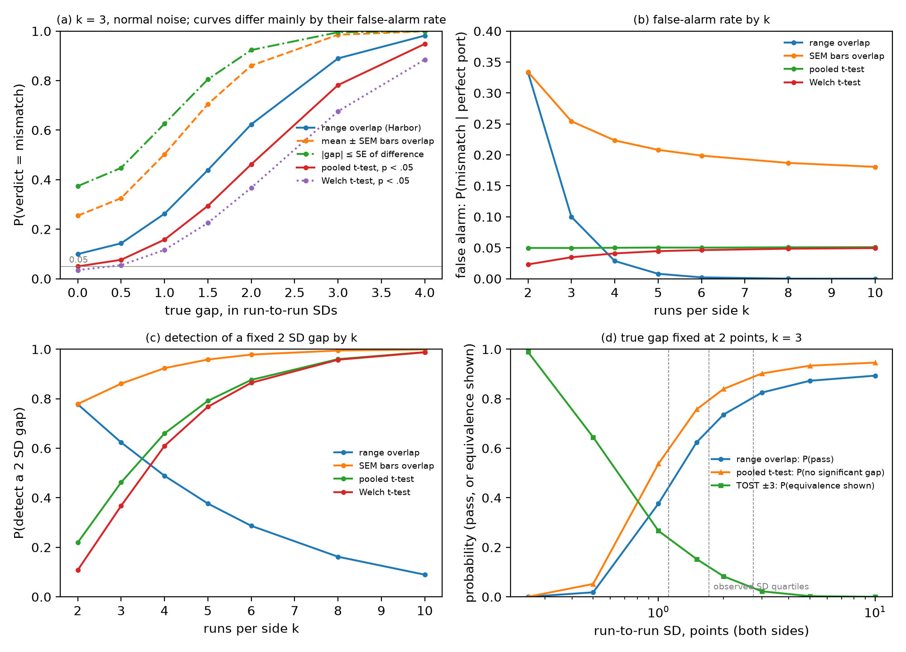
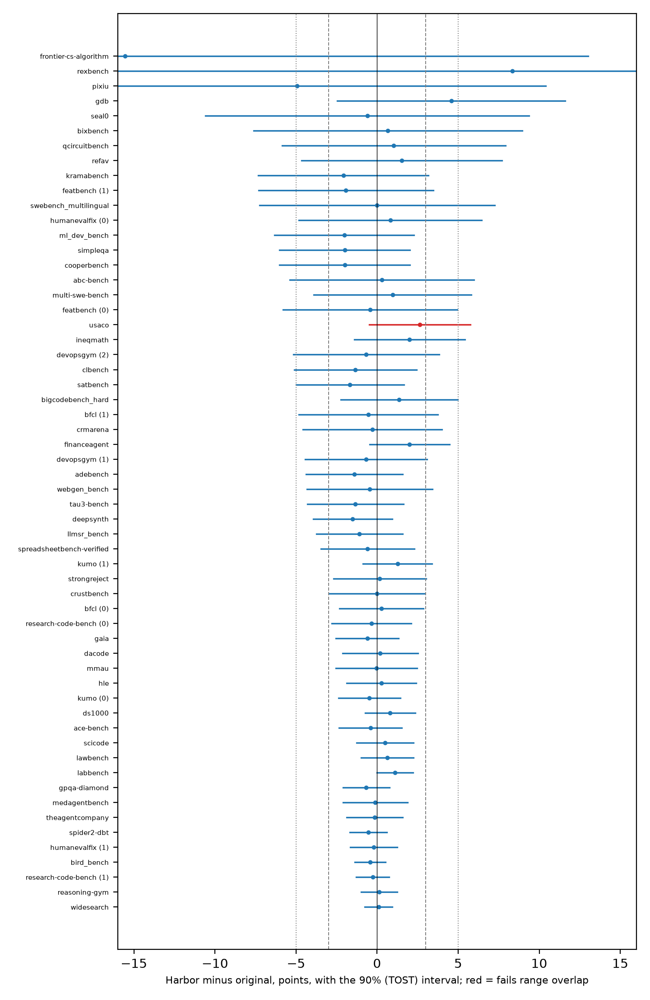
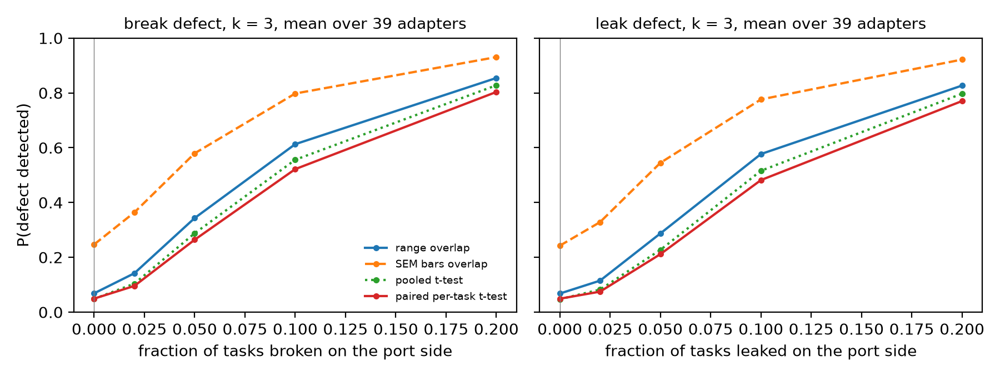

# How much does a parity experiment prove?

Poorva Barve. Results memo, October 2026. Code, data and every number: github.com/barveP/benchmark-port-parity.

## The question

Harbor is the evaluation framework behind Terminal-Bench. More than eighty existing benchmarks have been ported to it through "adapters", and the maintainers' cross-benchmark comparisons and their curated Harbor-Index task set are built on the ports. Each adapter must pass a parity experiment: the same agent and model are run on the original harness and on the port, usually three times each. The contributor guide states the pass rule in one line: the two sides match if and only if the ranges of their run scores overlap. The maintainers' paper words the check differently, as the two means agreeing "within a margin consistent with their standard errors".

We asked what the rule guarantees, what the published parity runs establish, and what a better check would cost. Everything here comes from public data: the 84 parity files in the Harbor repository, the per-task result files on Hugging Face, and the paper. We reran no benchmark.

**Short answer.** The rule is a test for a difference, not a test of equivalence. With three runs per side, a pass means only that a check with a false-alarm rate of up to 10% did not fire. The published runs look close (median gap size 0.7 points), but they can show equivalence within 3 points for only 22 of 58 comparisons and within 5 points for 36. A better check needs a margin stated in advance and more runs, about seven per side at the observed noise for a 3-point margin. We give a five-line protocol and a script.

## 1. What the rule guarantees

Range overlap is a statistic, and its error rates can be worked out exactly. If the port is perfect and runs are independent, the two ranges fail to overlap 10% of the time with three runs per side (exactly 2(3!)²/6!), whatever the shape of the run-to-run noise, as long as scores cannot tie. When scores are pass counts that can tie, the rate is lower, about 4 to 9% in the cases we computed. We call this the false-alarm rate: a perfect port flagged as a mismatch. With normal noise, the rule catches a real gap of two run-to-run standard deviations 62% of the time; a t-test tuned to the same false-alarm rate would catch it 64%. Inefficiency is not its problem. Its problems are these three.

- The false-alarm rate is set by the run count alone: 33%, 10%, 3%, 1% at two, three, four, five runs. It cannot be chosen.
- For any fixed gap, detection falls as runs are added. For a gap of two standard deviations it falls from 78% at two runs to 9% at ten, while a t-test's rises from 22% to 99%.
- Noise helps a port pass. For a true gap of 2 points and the same noise on both sides, the pass chance rises from 2% when the run-to-run standard deviation is half a point, to 68% at the published runs' typical 1.7 points, and towards 90% as the noise grows.

A pass therefore means "not rejected at the 10% level". It never means the port is within any stated distance of the original. The paper's wording describes a stricter check than the guide's rule: read literally, its two phrasings ("within a margin consistent with their standard errors" and "statistical equivalence ... within sample SEM") would flag 25 to 44% of perfect ports, depending on the reading.

*Figure 1. Five mismatch rules and one equivalence test under normal run-to-run noise; k is runs per side. (a) k = 3: chance of a mismatch verdict against the true gap in run-to-run standard deviations, for range overlap (Harbor's rule), two readings of the paper's wording (SEM bars overlap; gap within the standard error of the difference) and two 5% t-tests (pooled, Welch). (b) False-alarm rate against k. (c) Detection of a 2 SD gap against k. (d) For a true gap of 2 points and k = 3, against the run-to-run standard deviation: the chance that range overlap passes, that a t-test finds no significant gap, and that an equivalence test (TOST) shows equivalence within 3 points; vertical lines mark the quartiles of the published runs' standard deviation.*

## 2. What the published runs establish

The 84 files hold 121 experiments. Eighty-two compare an original harness with its port; 61 of those have three runs per side, and 58 remain after dropping two whose run lists are identical on both sides and one whose metric is not on a 0-to-100 scale. We built one comparison per experiment under rules written down after a first pass over the data and before this analysis (main metric, excluded rows, units); every later change is logged with its date. For each comparison we computed the gap (Harbor minus original), its 90% confidence interval, and the smallest provable margin: the distance from zero to the farther end of that interval. Equivalence within a margin is shown when the whole interval lies inside it. This is the standard two-one-sided-tests (TOST) procedure at the 5% level, which is why the interval is 90% rather than 95%.

The ports look close: the gaps have a median size of 0.7 points, and none is distinguishable from zero. But the evidence that they are close is thin: the median smallest provable margin is 4.4 points. Equivalence within 3 points can be shown for 22 of 58 comparisons and within 5 points for 36; one in four cannot show it even within 6 points. Twenty-one comparisons pass the overlap rule but cannot show equivalence within 5 points. The rule also passes the four largest gaps:

- Frontier-CS, 15.6 points (a 10-task subset; run-to-run standard deviation 16 points)
- RexBench, 8.3 points
- PIXIU, 4.9 points
- GDB, 4.6 points

The one comparison that fails the rule, USACO, misses overlap by 0.1 point, yet its smallest provable margin of 5.8 points is smaller than that of 18 of the 57 passes.

If every port were perfect and scores could not tie, the rule would flag about six of the 58 by chance alone, somewhat fewer when scores can tie; it flagged one. This is what the process implies: the contributor guide treats non-overlap as an adaptation error until evidence shows otherwise, to be diagnosed and fixed, and its parity step is complete only when the runs overlap, so, with one exception, the published records are the ones that ended up passing. The published pass rate therefore cannot be used to check the rule, and the rates in section 1 describe the rule under stated noise models, not the published ports.

*Figure 2. Gap (Harbor minus original, points) with its 90% interval for the 58 comparisons, ordered by the smallest provable margin, largest at the top. Equivalence within 3 or 5 points is shown when the whole interval lies between the dashed (±3) or dotted (±5) lines. Red: fails the overlap rule (USACO). Arrows: the interval continues beyond the frame. A number in brackets is the experiment index for adapters with several experiments.*

## 3. What a better check costs

**More runs.** Runs per side for an equivalence test with 80% power (an 80% chance of showing equivalence when the port is in fact perfect), at the run-to-run standard deviations observed in the 58 comparisons:

| margin | quiet quarter (SD 1.1) | typical (SD 1.7) | noisy quarter (SD 2.7) |
|---|---|---|---|
| 3 points | 4 | 7 | 16 |
| 5 points | 3 | 3 | 6 |

A true gap of 0.6 points, close to the observed median, raises these to 4, 8 and 18 for 3 points and 3, 4 and 7 for 5 points. Under the per-task noise model used below, whose spread is somewhat larger than the published runs show, three runs show equivalence within 5 points for a perfect port only about half the time (51%).

**Per-task results.** The published files already hold per-task results for most adapters, and the contributor guide's debugging playbook asks for a per-task split. Per-task files exist for 44 adapters with both sides; 27 meet our rule for a paired comparison (repeat runs of one experiment, enough shared tasks, files that reproduce the published run scores or carry a documented exception). Pairing does not tighten the interval for the gap. If both sides had the same chance of passing each task, the paired interval would be about a sixth narrower than the one from run scores, and only because three runs give a poor estimate of their own noise. In fact it is wider in 15 of the 26 adapters with a run-level interval (SWE-bench has a single original run), for two reasons. In 14 of 27 adapters the sides disagree on individual tasks more than shared per-task pass probabilities allow, even though their mean scores agree; run scores cannot reveal this, and the data cannot say whether it comes from the port or from side-specific effects such as seeds or caching. And on the Harbor side of 9 of the 30 adapters with yes/no task outcomes used in the next paragraph, the variance of the published run scores across runs is less than a tenth of what their own task-level churn implies if task outcomes are independent (financeagent reports 40 of 50 passes in each of three runs while individual tasks flip between runs), so the run-level interval is narrow for a reason the per-task data do not support. With three runs, some such cases are expected by chance. We report the count as an open data-quality question: either outcomes within a run are negatively dependent across tasks, or the runs are not independent repeats.

**What each test catches.** We simulated both sides from the per-task pass rates of 30 real adapters, broke or leaked a known share of tasks on the port side (broken tasks always fail there, leaked tasks always pass), and measured how often each test noticed. With three runs, a defect that breaks 10% of tasks (about 5 points) is caught by the overlap rule 64% of the time (at a 7% false-alarm rate under this model), by an ordinary two-sample t-test on the run scores 59%, and by a stratified-by-task test 67%, both at 5%. The stratified test compares the sides within each task and adds the evidence up across tasks. No test held at 5% does much better than two times in three, and a paired t-test on per-task differences does worse (54%), because a defect that hits a few tasks widens the spread of per-task differences, which that test counts as noise. With ten runs the two-sample t-test and the stratified test each catch it 86% of the time, the paired t-test 67%, and the overlap rule 36%.

*Figure 3. Chance of a mismatch verdict against the share of tasks a defect breaks (left, right) or leaks (middle), averaged over 30 adapters, with three runs per side (left, middle) and ten (right). Tests, named in the left-hand legend: range overlap, two-sample t-test on run scores, paired t-test on per-task differences, stratified-by-task test. Shaded bands: the middle half of adapters for the two-sample t-test and the stratified test. The point at zero is the false-alarm rate.*

## What we recommend

1. State the margin before running: how many points of difference would make the port a different benchmark.
2. Choose the run count from the noise, for 80% power at that margin (table above). When the noise is unknown, start with at least five runs per side and add runs once the noise is known; five is a floor, not a count that reaches 80% power.
3. Report the gap with its 90% interval and the smallest provable margin. Declare equivalence only when the interval lies inside the margin; otherwise say "not yet shown", not "mismatch".
4. Publish per-task outcomes on both sides with aligned task ids, and report a stratified-by-task test with them.
5. Keep range overlap as a sanity check at most.

The script `scripts/parity_verdict.py` reads any `parity_experiment.json` and prints the verdict, the smallest provable margin, and the runs needed.

## What this does not claim

No port is shown to be wrong; the gaps are mostly small. The maintainers published everything we used. Our noise models are simple (independent runs, shared per-task probabilities); we used three (normal run scores, pass counts over tasks, per-task pass rates from real runs) and all three rank the rules the same way. The counts at fixed margins in section 2 are fragile: shifting every margin by 0.1 points moves the within-5 count between 34 and 37, and a more conservative (Welch) interval lowers it from 36 to 31; the quartiles are the stable numbers. The detection rates in section 3 depend on how each task's pass rate is estimated from three runs; under the prior we registered first they fall by a third or more (overlap 43%, two-sample t-test 34%, stratified 45%). The published runs are too few to estimate any one port's noise well; the choice of main metric was pre-registered but is still a choice; metrics of different kinds (pass rates, F1, rewards) sit on one 0-to-100 scale; comparisons run on a subset of tasks are noisier than full-set ones (median run SD 2.3 against 1.5 points) and the main set mixes both; the per-task files lag the repository by months, so the paired analysis rests on 27 adapters, 6 of them documented exceptions; one headline comparison (MMAU) has per-task identical sides in the published files, so its two sides are not independent runs, and without it 21 of 57 comparisons show equivalence within 3 points and 35 of 57 within 5; the simulation assumes independent task outcomes, so its run-level rates are understated for the under-dispersed adapters; and this is one snapshot of a moving repository. The statistics literature already says that overlap tests are weak, and the equivalence-testing literature that equivalence needs a margin. What is new is the error analysis of the specific rule used to accept these ports, the audit of what their published runs can establish, and the cost of the fix.
